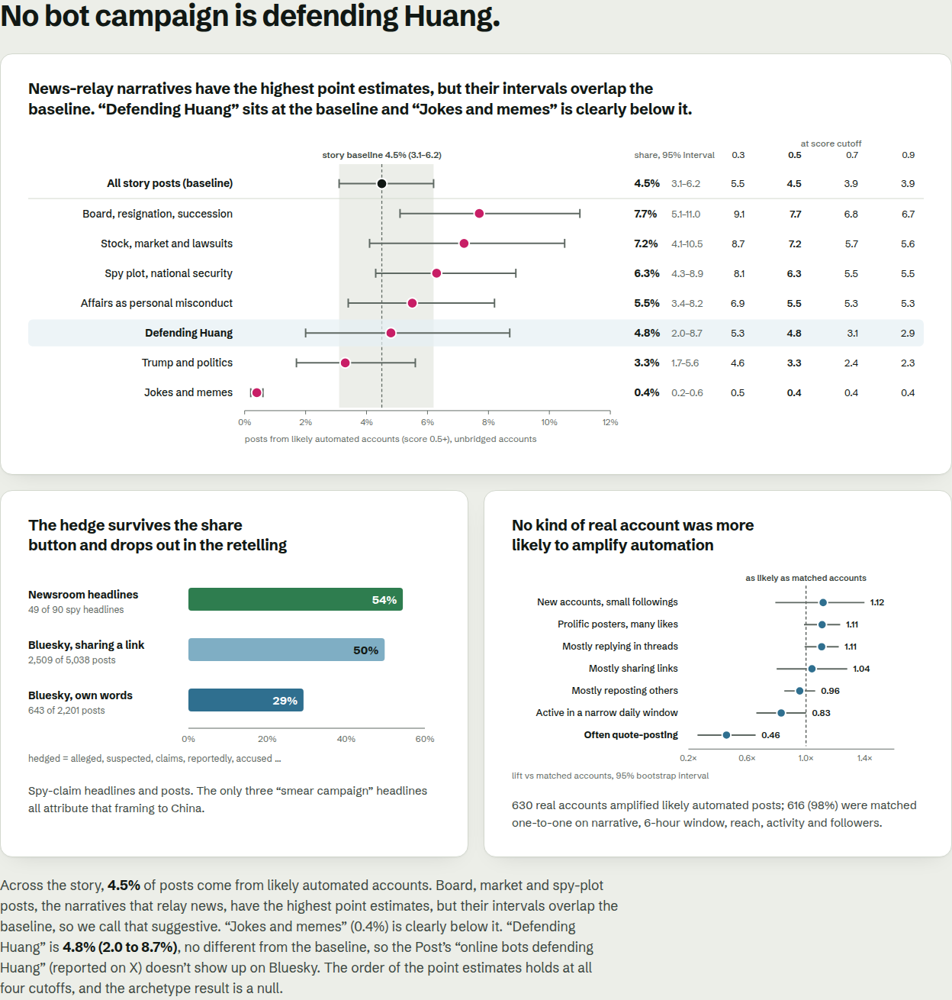
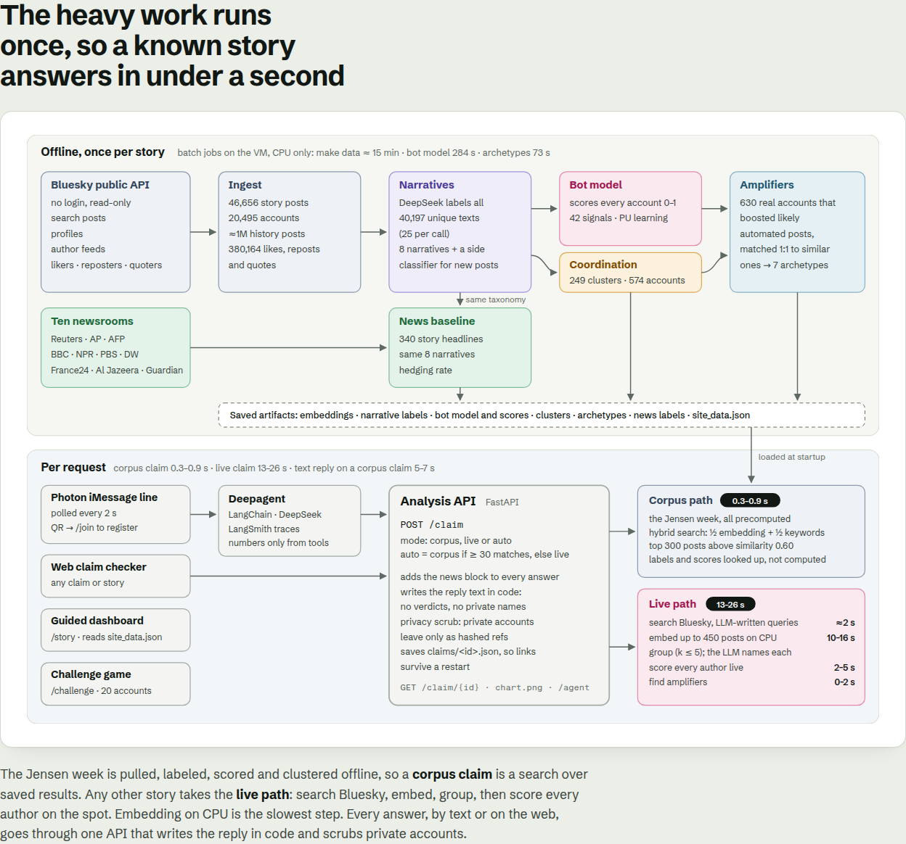

# Headcount

Volume is not consensus.

Headcount takes a claim or a story, finds the public Bluesky posts about it, and shows how much of that volume comes from likely automated accounts, which narratives they push, and which real people spread them. It never rules on whether a claim is true.

Built at HackPrinceton Fall 2026 for the Arlequin AI track, Social Media Analysis: Combining Content & Connectivity Patterns.

- Live: https://demoyk.com
- The guided story (Jensen Huang's resignation week): https://demoyk.com/story
- Spot the automation, a game with 20 real accounts: https://demoyk.com/challenge
- You can also text the agent a claim over iMessage (Photon). The number is on the Devpost page and in the demo.



## What we found

We ran it on the week Jensen Huang left Nvidia (Nov 5 to 13, 2026): 46,656 Bluesky posts from 20,495 accounts, plus the last 50 posts of each account.

- 4.5% of story posts (95% interval 3.1% to 6.2%) come from likely automated accounts. The Washington Post reported that "online bots" were defending Huang. On Bluesky that does not show: Defending Huang is 4.8% (2.0% to 8.7%), not different from the baseline.
- Among narratives, board, resignation and succession has the highest point estimate at 7.7% (5.1% to 11.0%), against the 4.5% baseline. The intervals overlap, so we call that suggestive, not a clear difference. Jokes and memes are clearly lowest at 0.4%. The order of the point estimates holds at all four score cutoffs we tried.
- Caution gets lost in the retelling. 54% of newsroom spy-claim headlines hedge ("alleged", "suspected", "claims"). Bluesky posts that share a link keep it (50%). Posts in people's own words mostly drop it (29%).

We also tested whether some kind of real account is more likely to amplify automation. After matching on narrative, time window, reach and activity, none was. That null result is in the report.

## How it works

Two layers, scored together.

- Content: every post is sorted into one of 8 narratives (DeepSeek labels, then a classifier for new posts), and claims are matched to posts with bge-small embeddings plus keyword search.
- Connectivity: accounts are scored 0 to 1 for automation from profile and behavior signals, plus coordination clusters (accounts posting the same link or the same post within 60 seconds, or near-identical text). The reposts, likes and quotes graph then shows which real accounts amplify the automated ones.

On the Jensen week the heavy work runs once offline, so a known story answers in under a second. Any other story takes the live path: search Bluesky, embed, group, score every author on the spot (13 to 26 seconds). Everything goes through one FastAPI service, and the web app, the iMessage line and the agent all read from it. See [docs/architecture.html](docs/architecture.html) for the full walkthrough, and [docs/TEAM-BRIEF.md](docs/TEAM-BRIEF.md) for the same thing in plain words.



## Results

| Measure | Result | Report |
|---|---|---|
| Bot model recall@100, held-out labeled bots | 0.356 ± 0.016 (mean of 5 splits) vs 0.045 for posting rate alone | [eval/bots/report-vm.md](eval/bots/report-vm.md) |
| Same, with every bot of an operator held out together (unseen operators) | 0.232 | [eval/bots/report-vm.md](eval/bots/report-vm.md) |
| Precision@50, top-scored accounts against labels | 0.96 | [eval/bots/report-vm.md](eval/bots/report-vm.md) |
| Claim retrieval recall@20, first 20 claims | 0.787 (all 50 claims: 0.646) | [eval/retrieval/report-hybrid.md](eval/retrieval/report-hybrid.md) |
| Narrative classifier agreement | 70% with the language-model labels | [eval/narratives/report.md](eval/narratives/report.md) |
| Narrative bot shares | per-narrative shares with intervals | [eval/bots/narrative_shares.md](eval/bots/narrative_shares.md) |
| Archetype test (amplifiers vs matched accounts) | null result | [eval/thesis/report-vm.md](eval/thesis/report-vm.md) |
| News baseline | hedging in newsroom headlines vs Bluesky | [eval/news/report.md](eval/news/report.md) |

## Limits

- The labeled bots are mostly disclosed news and trend bots, so recall is measured on the honest kind of automation. Precision against labels understates real precision, and campaign-style accounts need the coordination evidence next to the score.
- The 70% narrative agreement is against language-model labels. Hand labels are not finished.
- The claim headline needs 30 or more matching posts and an interval no wider than 25 points. Below that we say so.
- Bluesky only, one story week. Bluesky users are not X users, and the Post's report was about X.
- Amplification is what we can see. We cannot see belief, so we say "more likely to amplify", never "more easily fooled".

## Privacy and ethics

- Public data only: Bluesky's open API, read only, no login. Nothing is posted, liked or followed.
- Private accounts are counted and never named. Only accounts with 5,000 or more followers, verified accounts, news organizations, and accounts that label themselves bots appear by handle. Everyone else is a hashed ID.
- No verdicts on truth, and it never says who runs an account. An account is "likely automated" with reasons, not "a bot", unless it says so itself.
- No sensitive traits are inferred. The export refuses to write if its privacy sweep finds a private handle, and the reply text is composed in code with those rules under test.
- Raw data and anything with private handles stays out of git. `data/sample/` holds only hashed or public data.

## Tech stack

Python 3.11, FastAPI, Polars and Parquet tables, scikit-learn (gradient boosting), sentence-transformers (bge-small), datasketch (MinHash), igraph and leidenalg. DeepSeek for narrative labels, query writing and translation. LangChain deepagents with LangSmith traces for the agent. Photon Spectrum for the iMessage line. React, TypeScript and Vite for the web app. Remotion for the demo video.

## Repo map

```
src/ingest/        Bluesky search, profiles, author history
src/model/         table schemas, privacy hashing
src/narratives/    embeddings, clustering, labeling
src/bots/          features, coordination, training, narrative shares
src/archetypes/    amplifiers, matched controls, archetypes
src/retrieval/     claim search (corpus and live)
src/news/          newsroom headline baseline
src/api/           FastAPI analysis service and reply composer
src/agent/         LangChain deepagent
src/messaging/     Photon iMessage service
src/export/        builds web/public/site_data.json
eval/              evaluation reports and hand-check files
data/sample/       committed, privacy-safe samples
web/app/           the web app (/, /claim, /story, /challenge)
web/video/         demo video (Remotion)
docs/              architecture, team brief, plan, index in docs/README.md
tests/             pytest suite
```

## Quickstart

```sh
uv venv --python 3.11 && source .venv/bin/activate
uv pip install --index-strategy unsafe-best-match --extra-index-url https://download.pytorch.org/whl/cpu -r pyproject.toml
python -m pytest -q tests

cp .env.example .env              # fill in SALT and a DeepSeek key
make data                         # rebuilds the Jensen-week tables from Bluesky, about 15 minutes
python -m src.export.build_site_data
uvicorn src.api.app:app --port 8000

cd web/app && npm install
npm run sample-data               # only if web/public/site_data.json is missing
npm run dev                       # http://127.0.0.1:5173
```

The web app's own notes are in [web/app/README.md](web/app/README.md). The original build spec, with data contracts and table schemas, is in [docs/BUILD-PLAN.md](docs/BUILD-PLAN.md).

## Team

Isaac Kang ([@Ik301](https://github.com/Ik301)), David ([@DHyukjuK](https://github.com/DHyukjuK)), and [@ch4nbin](https://github.com/ch4nbin). We built with coding agents, coordinating in [docs/COMMS.md](docs/COMMS.md): Hermes ran the data pipeline, API, messaging and export, and Muse built the bot model, coordination clusters and archetype work.

## Acknowledgements

Bluesky and the AT Protocol for an open API. Photon for Spectrum and the iMessage line. DeepSeek for labeling and translation. LangChain and LangSmith for deepagents and traces. Arlequin AI for the track. Coordination method after Pacheco et al., ICWSM 2021. Fonts: Schibsted Grotesk and Fragment Mono (OFL).

License: MIT, see [LICENSE](LICENSE).
